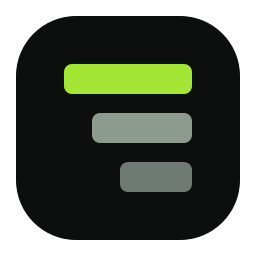

<h1 style="display:flex;align-items:center;gap:8px">Tokenly </h1>

A dashboard for visualising coding-agent token usage. It shells out to the
[`ccusage`](https://www.npmjs.com/package/ccusage) CLI, normalises the JSON it
returns, and renders daily and monthly breakdowns with charts and tables.

Runs entirely on your machine — nothing leaves it.

## Requirements

- Node.js 18.18+
- The `ccusage` CLI on your PATH

```bash
npm install -g ccusage
```

## Getting started

```bash
npm install
npm run dev
```

Open http://localhost:3000.

## Usage

Pick **Daily** or **Monthly**, and use the **Source** dropdown to scope the
report to one agent (`opencode`, `claude`, `codex`, `gemini`, …) or leave it on
**All sources**.

The dropdown maps directly onto the CLI:

| Selection     | Command                          |
| ------------- | -------------------------------- |
| All sources   | `ccusage daily --json`           |
| `opencode`    | `ccusage opencode daily --json`  |
| All sources   | `ccusage monthly --json`         |
| `claude`      | `ccusage claude monthly --json`  |

The footer always shows the command that produced the current view.

### Keyboard

The source dropdown is a custom listbox, not a native `<select>`:

| Key                      | Action                   |
| ------------------------ | ------------------------ |
| `ArrowDown` / `ArrowUp`  | Open the menu, then move |
| `Home` / `End`           | First / last option      |
| `Enter` / `Space`        | Select and close         |
| `Escape` / `Tab`         | Close, keeping the value |

Clicking outside the menu also closes it. The current selection is marked with a
check.

## How it works

```
app/api/usage/route.ts   GET /api/usage?view=daily|monthly&source=all|opencode|…
lib/ccusage.ts           spawns the CLI, parses JSON, normalises the rows
app/page.tsx             dashboard: fetch, state, charts, tables
```

The two CLI report shapes are not identical — the unified report labels its
buckets `period`, while a per-source report uses `date` (daily) or `month`
(monthly). `lib/ccusage.ts` flattens all three into one `period` key so the
frontend never has to care.

Only `view` and `source` reach the shell, and both are matched against a fixed
allowlist before the command is built (`lib/ccusage.test.ts` covers this).

## Scripts

| Script              | Does                                        |
| ------------------- | ------------------------------------------- |
| `npm run dev`       | Dev server on :3000                         |
| `npm run build`     | Production build                            |
| `npm start`         | Serve the production build                  |
| `npm test`          | Unit tests for the CLI adapter              |
| `npm run typecheck` | `tsc --noEmit`                              |

## Error handling

| Situation                              | What you see                                                    |
| -------------------------------------- | --------------------------------------------------------------- |
| `ccusage` not installed                | "The ccusage CLI was not found on your PATH." + install command   |
| Selected source has no usage           | "No daily usage recorded for `<source>`."                        |
| CLI returns invalid JSON               | "ccusage returned output that is not valid JSON." + debug hint    |
| CLI exits non-zero or times out (30s)  | The first line of stderr                                        |
| Unknown `view` / `source`              | HTTP 400 with a list of valid values                            |

## Notes

- Charts animate only on mount; switching filters is instant.
- The theme follows your OS by default and can be overridden with the
  header toggle — the choice is stored in `localStorage`.
- Your token data is read live from disk on every request, so it is never
  cached or stale.

## License

MIT