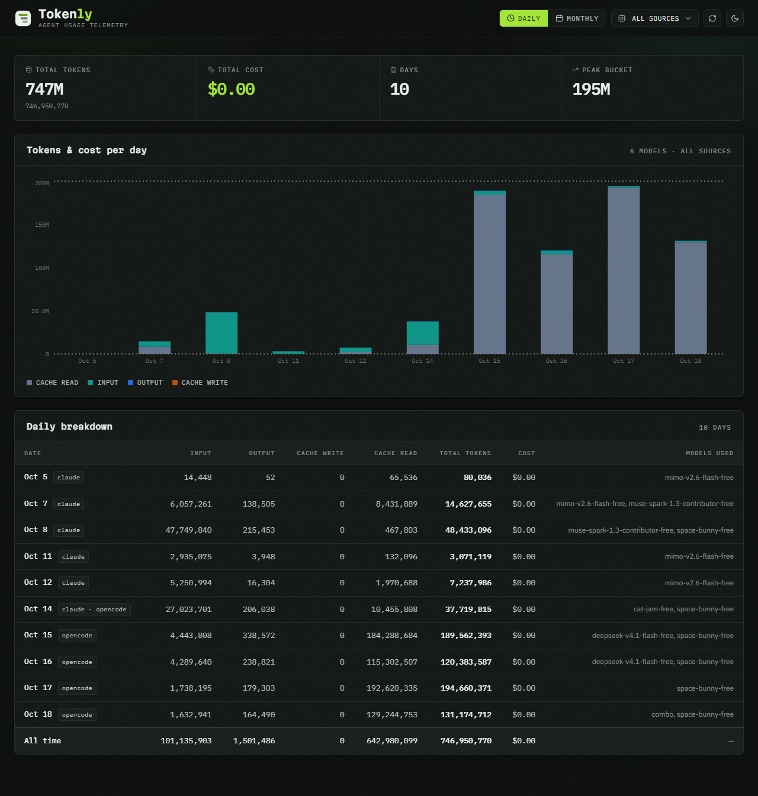
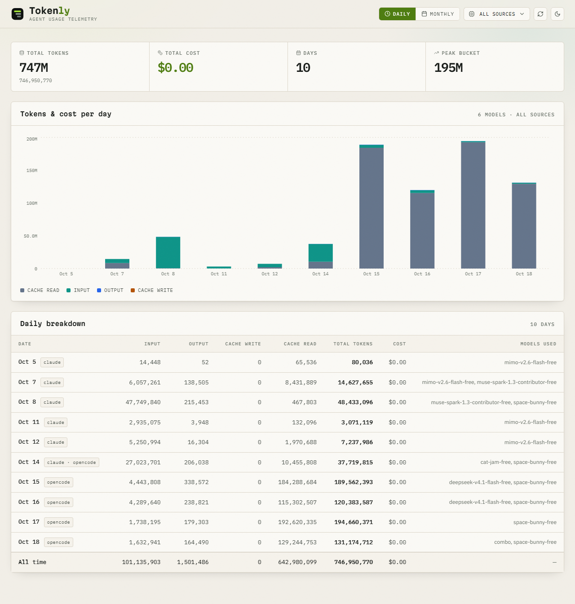

<h1 align="center">Tokenly</h1>

<p align="center">
  
</p>

<p align="center">
  A dashboard for visualising coding-agent token usage.
</p>

<p align="center">&nbsp;&nbsp;&nbsp;&nbsp;</p>

---

> Your agents burn millions of tokens a day. Tokenly reads the ledger and shows you where it went.

## Screenshots

<p align="center">
  
</p>

<p align="center">
  
</p>

## Requirements

- Node.js 18.18 or later
- The [`ccusage`](https://www.npmjs.com/package/ccusage) CLI on your PATH

```sh
npm install -g ccusage
```

## Getting started

```sh
git clone https://github.com/WhoisNeon/tokenly.git
cd tokenly
npm install
npm run dev
```

Open http://localhost:3000.

Everything runs on your machine. Tokenly reads your usage history from disk and never sends it anywhere.

## Usage

Pick **Daily** or **Monthly**, then use the **Source** dropdown to scope the report to a single agent (`opencode`, `claude`, `codex`, `gemini`, and 14 more) or leave it on **All sources**.

The dropdown maps directly onto the CLI:

| Selection   | Command                         |
| ----------- | ------------------------------- |
| All sources | `ccusage daily --json`          |
| `opencode`  | `ccusage opencode daily --json` |
| All sources | `ccusage monthly --json`        |
| `claude`    | `ccusage claude monthly --json` |

The footer always shows the command that produced the current view.

### Keyboard

The source dropdown is a custom listbox, not a native `<select>`:

| Key                     | Action                   |
| ----------------------- | ------------------------ |
| `ArrowDown` / `ArrowUp` | Open the menu, then move |
| `Home` / `End`          | First / last option      |
| `Enter` / `Space`       | Select and close         |
| `Escape` / `Tab`        | Close, keeping the value |

Clicking outside the menu also closes it, and the current selection is marked with a check.

## How it works

```
app/api/usage/route.ts   GET /api/usage?view=daily|monthly&source=all|opencode|…
lib/ccusage.ts           spawns the CLI, parses JSON, normalises the rows
app/page.tsx             dashboard: fetch, state, charts, tables
```

The two CLI report shapes are not identical. The unified report labels its buckets `period`, while a per-source report uses `date` (daily) or `month` (monthly). `lib/ccusage.ts` flattens all three into a single `period` key so the frontend never has to care which shape it received.

Only `view` and `source` ever reach the shell, and both are matched against a fixed allowlist before a command is built. `lib/ccusage.test.ts` covers that boundary.

## Scripts

| Script              | Does                           |
| ------------------- | ------------------------------ |
| `npm run dev`       | Dev server on :3000            |
| `npm run build`     | Production build               |
| `npm start`         | Serve the production build     |
| `npm test`          | Unit tests for the CLI adapter |
| `npm run typecheck` | `tsc --noEmit`                 |

## Error handling

| Situation                             | What you see                                                    |
| ------------------------------------- | --------------------------------------------------------------- |
| `ccusage` is not installed            | "The ccusage CLI was not found on your PATH." + install command |
| The selected source has no usage      | "No daily usage recorded for `<source>`."                        |
| The CLI returns invalid JSON          | "ccusage returned output that is not valid JSON." + debug hint   |
| The CLI exits non-zero or times out   | The first line of stderr (30s timeout)                           |
| Unknown `view` or `source`            | HTTP 400 listing the valid values                                |

## Notes

- Charts animate once on mount; switching filters is instant.
- The theme follows your OS by default and can be overridden from the header, which is stored in `localStorage`.
- Data is read live on every request, so it is never cached or stale. A cold `ccusage` run takes about a second.

## License

[MIT](LICENSE)