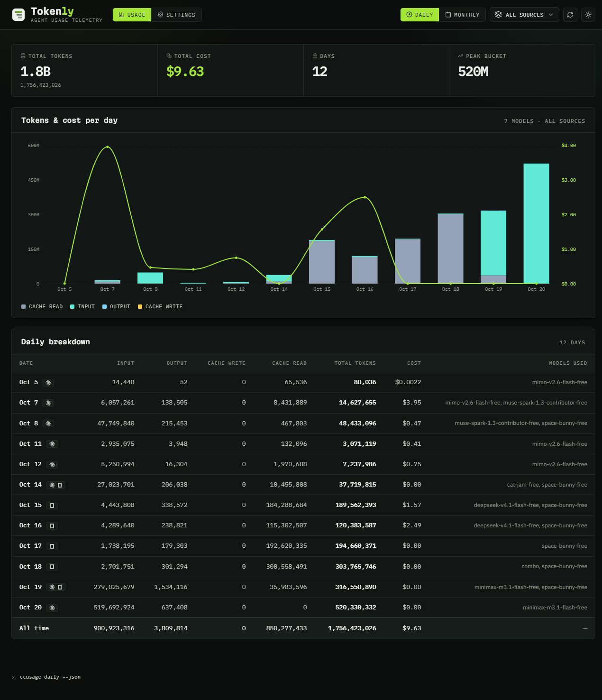
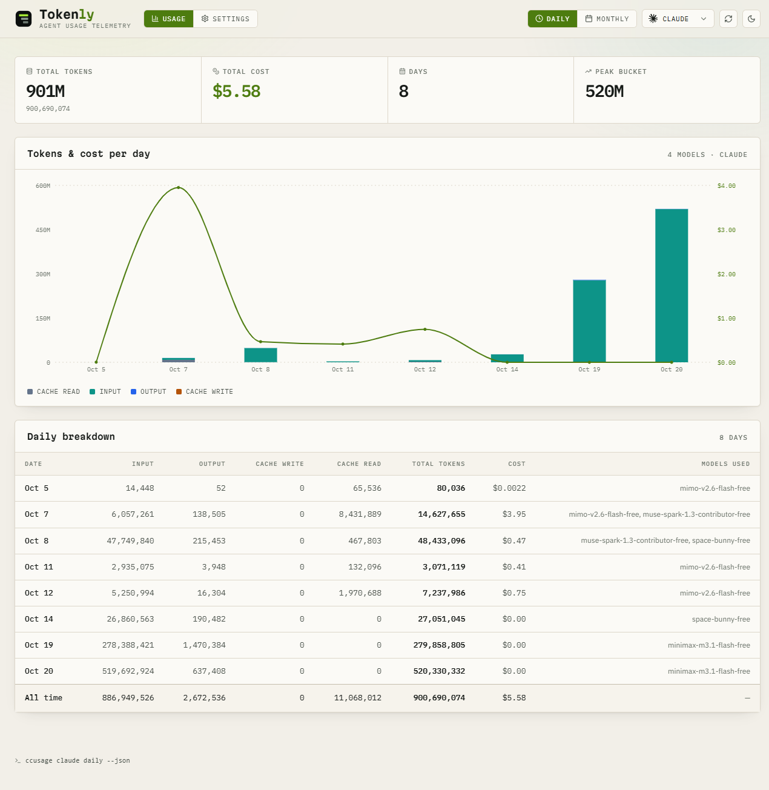
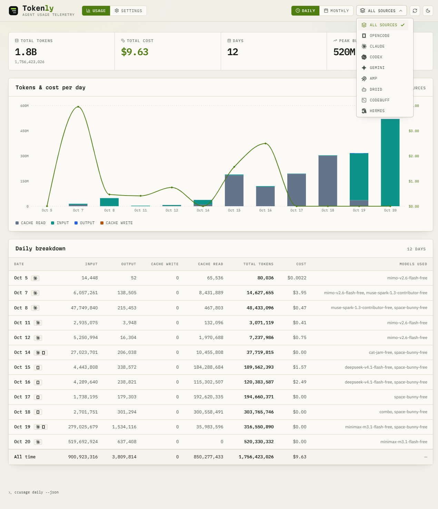
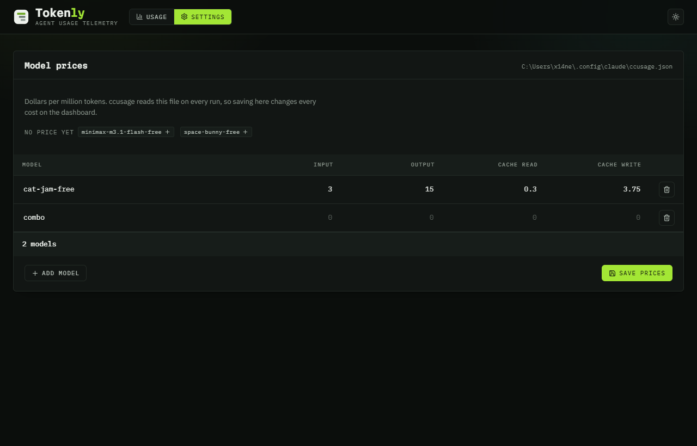

<h1 align="center">Tokenly</h1>

<p align="center">
  
</p>

<p align="center">
  A dashboard for visualising coding-agent token usage.
</p>

<p align="center">&nbsp;&nbsp;&nbsp;&nbsp;</p>

---

> Your agents burn millions of tokens a day. Tokenly reads the ledger and shows you where it went.

## Screenshots

|                                                |                                              |
| ---------------------------------------------- | -------------------------------------------- |
|  |  |
| **Daily, every agent** — tokens per day, split by input, output and cache. | **One agent** — the same report scoped to a single source. |
|  |  |
| **The source picker** — every agent has a mark; the check marks the current one. | **Settings** — model prices, written straight to the ccusage config. |

<br />

## Requirements

- Node.js 18.18 or later
- The [`ccusage`](https://www.npmjs.com/package/ccusage) CLI on your PATH

```sh
npm install -g ccusage
```

## Getting started

```sh
git clone https://github.com/WhoisNeon/tokenly.git
cd tokenly
npm install
npm run dev
```

Open http://localhost:3000.

Everything runs on your machine. Tokenly reads your usage history from disk and never sends it anywhere.

## Usage

The **Usage** tab picks **Daily** or **Monthly**, then use the **Source** dropdown to scope the report to a single agent (`opencode`, `claude`, `codex`, `gemini`, and 14 more) or leave it on **All sources**.

Every choice has a URL of its own, so a report can be linked to or reloaded as it is:

| URL                     | Report                                    |
| ----------------------- | ----------------------------------------- |
| `/usage/daily/all`      | Every agent, grouped by day               |
| `/usage/monthly/all`    | Every agent, grouped by month             |
| `/usage/daily/claude`   | Claude Code only, grouped by day           |
| `/usage/monthly/claude` | Claude Code only, grouped by month         |
| `/settings`             | The price editor                          |

The dropdown maps directly onto the CLI:

| Selection   | Command                         |
| ----------- | ------------------------------- |
| All sources | `ccusage daily --json`          |
| `opencode`  | `ccusage opencode daily --json` |
| All sources | `ccusage monthly --json`        |
| `claude`    | `ccusage claude monthly --json` |

The footer always shows the command that produced the current view.

### Keyboard

The source dropdown is a custom listbox, not a native `<select>`:

| Key                     | Action                   |
| ----------------------- | ------------------------ |
| `ArrowDown` / `ArrowUp` | Open the menu, then move |
| `Home` / `End`          | First / last option      |
| `Enter` / `Space`       | Select and close         |
| `Escape` / `Tab`        | Close, keeping the value |

Clicking outside the menu also closes it, and the current selection is marked with a check. Every
agent has a mark — a set of monochrome SVGs served from jsDelivr — so the agents are told apart at
a glance without reading their names.

## Settings

The **Settings** tab edits the prices `ccusage` charges for each model. It reads and writes

```
~/.config/claude/ccusage.json
```

the same file the `ccusage` CLI discovers on its own, so a saved price changes every cost on the
dashboard with no restart and no extra flag.

| Column        | ccusage field                     |
| ------------- | --------------------------------- |
| Input         | `inputCostPerToken`               |
| Output        | `outputCostPerToken`              |
| Cache read    | `cacheReadInputTokenCost`         |
| Cache write   | `cacheCreationInputTokenCost`     |

Prices are entered as **dollars per million tokens** (`3` means $3 per million) and written as
per-token rates, which is what the config file stores. Every field of a row is written on save,
because a `ccusage` override replaces a model's whole price entry rather than merging into it.

Models `ccusage` has no price for are listed under **No price yet**; clicking one adds a row for
it. Saving re-runs `ccusage` and refreshes the dashboard.

Two things the editor leaves alone, on purpose:

- Other keys in the config file. Only `defaults.pricingOverrides` is rewritten.
- Per-agent price overrides. If an agent sets its own prices they win over the defaults, so the
  Settings tab says so rather than pretending to have changed them.

## How it works

```
app/usage/[view]/[source]/page.tsx  the report for one URL
app/settings/page.tsx              the price editor
app/api/usage/route.ts   GET /api/usage?view=daily|monthly&source=all|opencode|…
app/api/pricing/route.ts GET, POST /api/pricing — read and write the ccusage config
lib/ccusage.ts           spawns the CLI, parses JSON, normalises the rows
lib/pricing.ts           reads and writes ~/.config/claude/ccusage.json
components/AppShell.tsx  header, navigation, footer
components/UsageView.tsx the report: fetch, state, charts, tables
components/PricingEditor.tsx  the price table
```

The two CLI report shapes are not identical. The unified report labels its buckets `period`, while a per-source report uses `date` (daily) or `month` (monthly). `lib/ccusage.ts` flattens all three into a single `period` key so the frontend never has to care which shape it received.

Only `view` and `source` ever reach the shell, and both are matched against a fixed allowlist before a command is built. `lib/ccusage.test.ts` covers that boundary.

The Settings tab never shells out. `lib/pricing.ts` reads and writes the config file directly, so
there is no command to inject anything into.

## Scripts

| Script              | Does                                    |
| ------------------- | --------------------------------------- |
| `npm run dev`       | Dev server on :3000                     |
| `npm run build`     | Production build                        |
| `npm start`         | Serve the production build              |
| `npm test`          | Unit tests for the CLI and config adapter |
| `npm run typecheck` | `tsc --noEmit`                          |

## Error handling

| Situation                             | What you see                                                    |
| ------------------------------------- | --------------------------------------------------------------- |
| `ccusage` is not installed            | "The ccusage CLI was not found on your PATH." + install command |
| The selected source has no usage      | "No daily usage recorded for `<source>`."                        |
| The CLI returns invalid JSON          | "ccusage returned output that is not valid JSON." + debug hint   |
| The CLI exits non-zero or times out   | The first line of stderr (30s timeout)                           |
| Unknown `view` or `source`            | HTTP 400 listing the valid values                                |
| The config file is not valid JSON     | The parse error, and the file is left alone                       |
| A price is negative                   | The row is rejected and the file is not written                   |

## Notes

- Charts animate once on mount; switching filters is instant.
- The theme follows your OS by default and can be overridden from the header, which is stored in `localStorage`.
- Data is read live on every request, so it is never cached or stale. A cold `ccusage` run takes about a second.
- Tokenly only reads and writes `~/.config/claude/ccusage.json`. It never touches your usage data.

## License

[MIT](LICENSE)