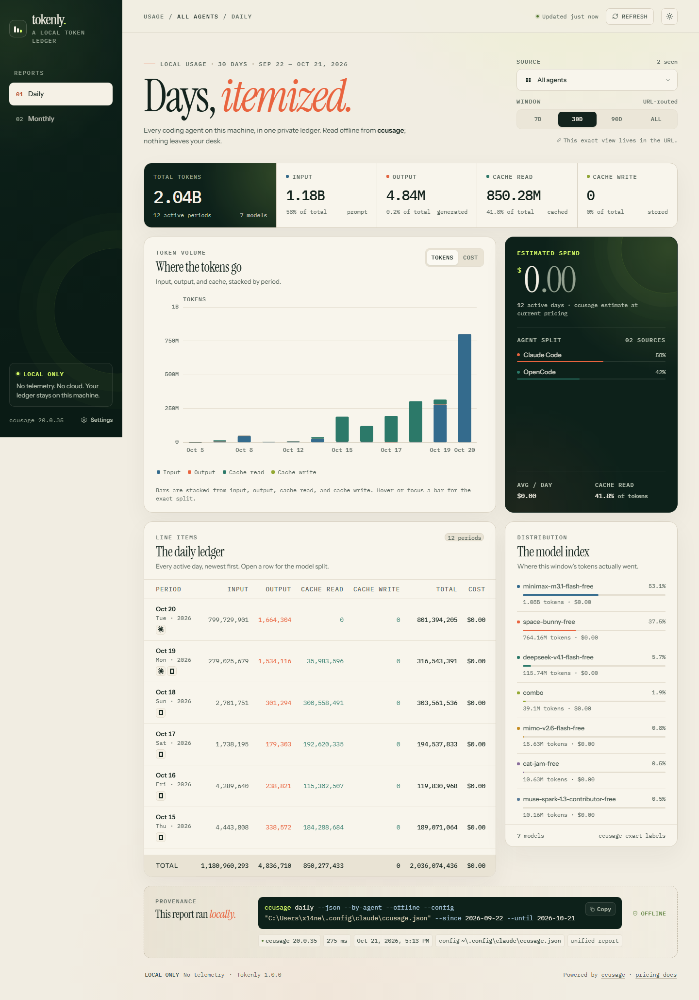
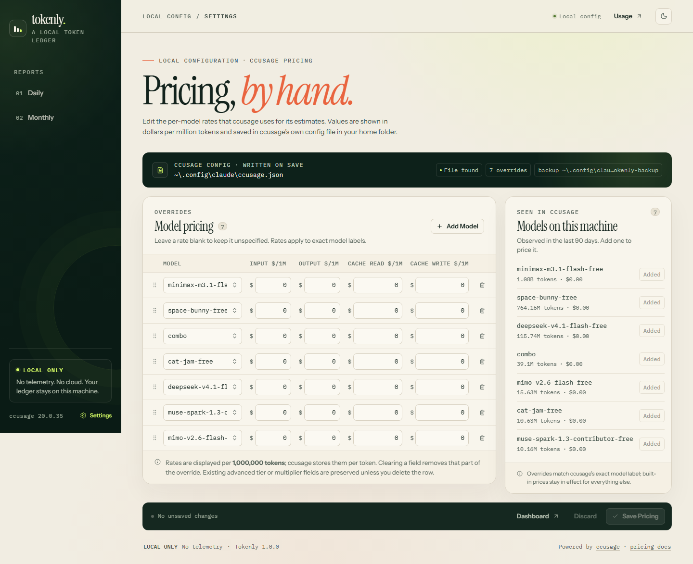
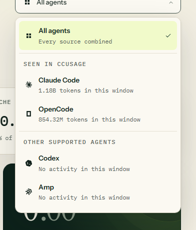
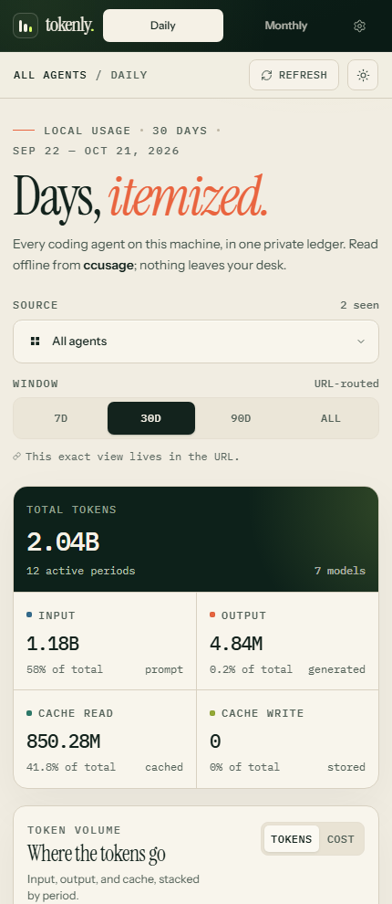
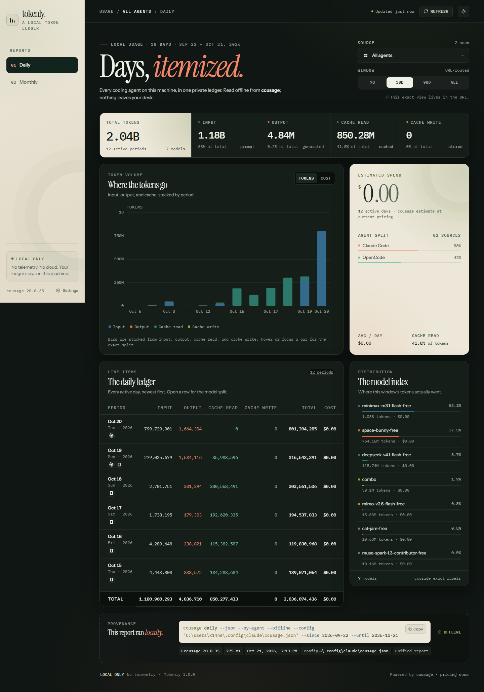

<p align="center">
  
</p>

<p align="center">
  <strong>A private, offline dashboard for coding-agent token usage.</strong><br />
  Reads the ccusage data already on your machine. Nothing leaves it.
</p>

<p align="center">
  
  
  
  
</p>

---

**Tokenly** turns the usage data [ccusage](https://ccusage.com/guide/) already keeps
on your machine into a warm, editorial dashboard: daily and monthly reports, stacked
token charts, model and agent splits, a record of the exact command behind every
report, and a friendly table for ccusage pricing overrides.

It is a single local Node.js server with **zero runtime dependencies**, no build step,
no analytics, and no outbound requests.

## Contents

- [Why Tokenly](#why-tokenly)
- [Showcase](#showcase)
- [Interface](#interface)
- [Reports at a glance](#reports-at-a-glance)
- [Requirements](#requirements)
- [Quick start](#quick-start)
- [Command provenance](#command-provenance)
- [Pricing settings](#pricing-settings)
- [Privacy by design](#privacy-by-design)
- [How it reads usage](#how-it-reads-usage)
- [Configuration](#configuration)
- [Tests](#tests)
- [Project layout](#project-layout)
- [Notes and limits](#notes-and-limits)
- [License](#license)

## Why Tokenly

Agent usage is scattered across Claude Code, Codex, OpenCode, and a dozen other
tools. ccusage already knows how to read all of them; Tokenly gives that data a
place to live.

- **One ledger.** Every ccusage source in a single report, or focused on one agent.
- **Readable at a glance.** Token mix, cost, cache behavior, and period-over-period
  rows without spreadsheet archaeology.
- **Source-aware.** Every ledger row carries that coding agent's own mark, the real
  brand vector from [LobeHub](https://lobehub.com/icons), painted monochrome so it
  follows the theme — no icon font, no CDN, no request.
- **Easy on the eyes.** A warm light palette and a dark one over the same design
  tokens, themed by your system or by one click of the header toggle.
- **Honest numbers.** Unpriced models are called out instead of silently costing
  `$0.00`.
- **Provable.** Every report shows the exact command it ran, with a copy button.
- **Private by construction.** Local server, bundled fonts, strict CSP, no network.

## Showcase

<table>
  <tr>
    <td width="50%" valign="top">
      
      <br />
      <sub><strong>Daily ledger.</strong> Totals for tokens, cost, and cache; a stacked
      token chart with a cost toggle; and every active day, itemized.</sub>
    </td>
    <td width="50%" valign="top">
      
      <br />
      <sub><strong>Pricing settings.</strong> Edit ccusage overrides per 1M tokens, see
      which models ran recently, and save with a backup of the previous config.</sub>
    </td>
  </tr>
  <tr>
    <td width="50%" valign="top">
      
      <br />
      <sub><strong>Custom source picker.</strong> Keyboard-operable dropdown that groups
      the agents you actually use, with the token volume for the current window.</sub>
    </td>
    <td width="50%" valign="top">
      
      <br />
      <sub><strong>Same ledger, smaller glass.</strong> The layout collapses to a sticky
      top bar, one-column controls, and horizontally scrollable tables.</sub>
    </td>
  </tr>
  <tr>
    <td colspan="2" valign="top">
      
      <br />
      <sub><strong>Dark theme, same tokens.</strong> The palette inverts — the deep-green
      panels of the light theme turn cream on a near-black page — and the header toggle
      moves between them with a circular reveal.</sub>
    </td>
  </tr>
</table>

## Interface

- **Two themes, one set of tokens.** With no stored choice the page follows
  `prefers-color-scheme`, so the very first paint is already correct; the header
  toggle stores an explicit choice and the change arrives as a circular reveal that
  grows out of the button (`clip-path` on a View Transition, held still under
  `prefers-reduced-motion`).
- **Icons are Lucide.** Every glyph in the app — refresh, settings, chevrons, the
  theme toggle, the drag grip, the dialog marks — is an inline Lucide path. There is
  no icon font, sprite, or build step. The agent marks are the one exception: real
  LobeHub brand vectors filled with `currentColor`, so they read as ink in either
  theme. The one raster asset, the Codebuff mark, is a monochrome mask that takes the
  same ink.
- **Pick where you look.** The report-source picker and the model field's suggestion
  list are custom listboxes (`role="listbox"`/`role="option"`, `aria-activedescendant`,
  arrows, Home/End, Enter, Space, Escape); the model list filters as you type and
  offers the models already in your config.
- **Reorderable pricing rows.** Every row has a drag handle. Drag it, or focus it and
  press the up/down arrows, to move the row; the move is announced to screen readers.
- **Dialogs that match.** Destructive actions and the unsaved-changes guard use the
  app's own dialog and palette instead of the browser's `confirm`.

## Reports at a glance

| View | URL | What it gives you |
| --- | --- | --- |
| Daily | `/usage/all/daily?range=30d` | Every active day with input, output, cache read, cache write, total, and cost. Windows: `7d`, `30d`, `90d`, `all`. |
| Monthly | `/usage/all/monthly?range=12m` | The same columns rolled up by month. Windows: `6m`, `12m`, `24m`, `all`. |
| Focused | `/usage/claude/daily?range=7d` | The same report for one source (Claude Code, Codex, OpenCode, …). |
| Settings | `/settings` | Pricing overrides, config location, backup status, and detected models. |

Every view is a real URL — reload it, bookmark it, or use back/forward. The source
picker and window buttons use client-side navigation without browser link previews.

Each period row expands into a model split and an agent split. On the side, the model
index shows share of tokens, cost, and unpriced-model warnings.

## Requirements

- **Node.js 20+**
- **ccusage** installed and on your `PATH`:
  ```bash
  npm install -g ccusage
  ```
- A ccusage config (optional). Tokenly creates one the first time you save pricing.

Tokenly itself has **zero runtime dependencies** and does not need an `npm install`.

## Quick start

Double-click **`start.cmd`**, or run:

```bash
npm start
```

Open **http://127.0.0.1:4777**.

The server binds only to `127.0.0.1`. Use a different port if needed:

```bash
node server.mjs --port 4781
# or
TOKENLY_PORT=4781 npm start
```

In Windows PowerShell, set it with `$env:TOKENLY_PORT = '4781'`. `start.cmd` also
opens the browser for you.

## Command provenance

Every report ends with the exact command Tokenly executed, including the config file
and date window, and lets you copy it. Tokenly passes `--offline` on every ccusage run
so reports use the local price snapshot instead of fetching updates.

For an all-agent daily view, that is the equivalent of:

```bash
ccusage daily --json --by-agent --offline --config "<home-config>" --since 2026-09-21 --until 2026-10-20
```

Focused views replace the unified command with, for example:

```bash
ccusage claude monthly --json --offline --config "<home-config>" --since 2025-11-01 --until 2026-10-20
```

Reports are cached in memory for 20 seconds to keep agent and window switching fast.
The **Refresh** button bypasses that cache.

## Pricing settings

- Rates are displayed as **USD per 1M tokens**; ccusage stores per-token values, and
  Tokenly converts between the two on load and save.
- Saves go directly to the user ccusage config in your home folder.
- The previous file is backed up to `<config>.tokenly-backup` before each save. If a
  backup cannot be written, the save still happens and Tokenly says so.
- If Windows denies writing in the config folder (`EPERM`, often Controlled Folder
  Access or tightened permissions), Settings shows a read-only badge, refuses to
  half-write, and gives you the exact `icacls` fix. Set `TOKENLY_CONFIG_PATH` to point
  at a writable copy if you prefer.
- Unknown top-level keys and advanced per-model fields (tiered pricing, multipliers)
  are preserved. Invalid JSON is never overwritten.
- Saving clears the report cache and refreshes open dashboards through a local
  Server-Sent Events connection.
- Each row has a drag handle: drag it, or focus it and press ↑/↓, to reorder the
  overrides, and the table is saved in the order you see.
- The model field suggests the models already in your config and filters as you type.
- Navigating away with unsaved changes asks first, in the app's own dialog.

Config resolution follows ccusage's user-config locations:

1. `~/.config/claude/ccusage.json` (created if neither file exists)
2. `~/.claude/ccusage.json`

Project-local config files are not edited. Tokenly passes the chosen home config to
reports with `--config`, so the saved rates are the rates shown.

### Failure states

| Code | What happened |
| --- | --- |
| `CCUSAGE_NOT_FOUND` | ccusage is missing or not on `PATH`. |
| `CCUSAGE_FAILED` | ccusage exited with an error. |
| `CCUSAGE_BAD_DATA` | Malformed JSON or an unexpected report shape. |
| timeout / oversized output | ccusage took too long or printed too much. |
| `CONFIG_INVALID` | The ccusage config is malformed; it will not be overwritten. |
| permission errors | Read or write access was denied. |
| empty window | No usage in the selected range. |

Each state includes a next step, and command-based errors include the command to run
manually.

## Privacy by design

- Server listens on `127.0.0.1` only.
- Fonts are bundled locally; there are no CDN or Google Fonts requests.
- A strict Content Security Policy keeps the page on its own origin.
- No analytics, telemetry, remote logging, or cloud storage.
- ccusage is always invoked with `--offline`.
- External documentation links are ordinary links that only send a request on click.
- Settings writes require a same-origin request plus a custom `X-Tokenly` header.

## How it reads usage

`lib/report.mjs` builds the ccusage invocation, parses and validates the JSON, then
normalizes rows, model breakdowns, and per-agent splits. The browser receives a
ready-to-render report and never talks to ccusage directly.

The UI is dependency-free: `public/app.js` renders the views, `public/charts.js` draws
responsive SVG charts by hand, and `public/formatters.js` handles numbers, dates, and
currency with `Intl`.

## Configuration

| Variable | Purpose |
| --- | --- |
| `TOKENLY_PORT` | HTTP port (default `4777`) |
| `TOKENLY_CONFIG_PATH` | Use a specific config path instead of home discovery |
| `CCUSAGE_BIN` | Use a specific ccusage CLI entry point |
| `TOKENLY_OPEN=1` | Open the browser after starting |

## Tests

```bash
npm test
```

The suite covers range calculation, command construction, per-token/per-million
conversion, backup and preservation behavior, invalid-config refusal, report
normalization, focused/unified reports, and malformed ccusage output. Tests use
temporary files and a fake ccusage script; they never touch your real config.

## Project layout

```text
server.mjs              local HTTP server, APIs, static assets, SSE
lib/ccusage.mjs         finds and runs ccusage, captures output safely
lib/config.mjs          config discovery, validation, atomic writes and backups
lib/report.mjs          report commands, JSON normalization, aggregation, cache
lib/constants.mjs       sources, ranges, pricing fields
public/app.js           single-page UI, routing, Lucide icons, custom dropdowns,
                        reorderable settings rows
public/charts.js        dependency-free responsive SVG charts
public/formatters.js    Intl-based number/date/currency formatting
public/agent-marks.js   inline 24x24 LobeHub brand marks for the agent roster
public/agent-codebuff.png  monochrome mask for the Codebuff mark
public/styles.css       the interface
public/fonts/           bundled fonts and OFL licenses
public/logo.svg         the Tokenly lockup used above
docs/screenshots/       screenshots captured from the running app
test/tokenly.test.mjs   Node test suite
```

## Notes and limits

- Built against ccusage `20.0.35`'s JSON shape (`daily` / `monthly`, `by-agent`,
  `modelBreakdowns`, `missingPricing`, and per-token `pricingOverrides`). If a future
  release changes that shape, Tokenly shows the bad-data state instead of guessing.
- Costs are ccusage's estimate. **Unpriced** models count at `$0.00`; add an override
  if you want them costed.
- Figures are only as current as the ccusage data on disk. Press Refresh after new
  agent activity.
- `~` in the UI is shorthand for your home folder; executed commands use the full path.

## License

[MIT](./LICENSE) © 2026 WhoisNeon

Tokenly bundles Instrument Serif, Instrument Sans, and IBM Plex Mono. Their licenses
are in [`public/fonts/licenses/`](./public/fonts/licenses/). Lucide icons are inlined
under the ISC License, the agent marks come from LobeHub and the Codebuff mask from
that product's own favicon, and all of them stay under their owners' terms. Every
license is summarized in [`THIRD_PARTY_NOTICES.md`](./THIRD_PARTY_NOTICES.md).
